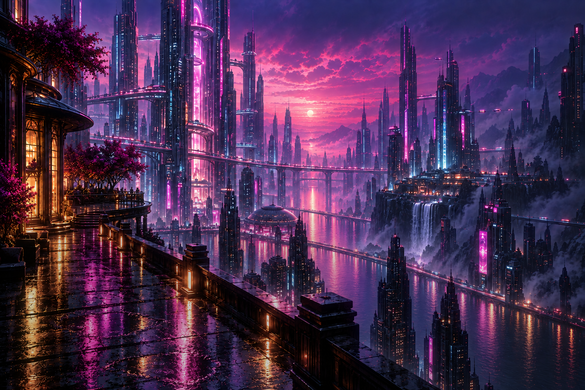

# Neon Horizon — Mac Makeover

A clean, magenta Mac desktop with an animated cyberpunk painting, a calmer Dock, a tidier Finder, and optional two-second edge switching between desktops.



**Start here:** [Setup guide](docs/SETUP.md) · [Wallpaper design notes](docs/WALLPAPER.md) · [Another-Mac setup prompt](docs/SETUP-PROMPT.md) · [What is included](docs/CHANGELOG.md)

## Use it

1. Copy or unzip the entire `neon-horizon-mac` folder onto your Mac.
2. Open `wallpaper/index.html` to preview the finished animation.
3. Double-click **Start.command**. Choose **1** to preview, then **2** to apply the complete native preset after reviewing it. The setup tool needs [Python 3](https://www.python.org/downloads/macos/); the wallpaper and manual guide do not.
4. Follow [Setup](docs/SETUP.md) for Plash, the remaining native UI settings, and optional desktop controls.

The preset offers **39 settings in seven groups**. It saves the original values outside the repository before changing them. It never replaces your Dock app list, moves your existing files, changes key-repeat speed, installs apps, grants permissions, or restarts your Mac.

For a smaller selection, open a terminal in this folder:

```sh
python3 makeover.py plan --groups appearance,dock,finder
python3 makeover.py apply --groups appearance,dock,finder
```

The available groups are `appearance`, `dock`, `finder`, `desktop`, `calendar`, `clipboard`, and `corners`; `all` selects every group. With no group argument, the tool uses the first five. The clipboard group enables native seven-day history; macOS controls which copied items it retains.

## Animated wallpaper

Rain that gusts and obeys aerial perspective, landing across the whole wet promenade and the near river. Traffic on the bridges and two aerial lanes. The sun's reflection crawling on the water. Neon ballast stutter, windows coming on over minutes, distant lightning at the peak of a seven-minute storm cycle. A near-promenade plane that dollies against the camera for real depth, and a source-derived bloom that makes every light in the painting halate.

Everything is embedded in one HTML file. It works offline, has no audio or tracking, respects Reduce Motion, and pauses when the browser reports it hidden. No two large-area animations share a prime factor, so the scene does not repeat inside ~39 minutes.

Open `index.html#calm` to run every animation at one third speed on battery.

Use [Plash](https://sindresorhus.com/plash) to place it behind your windows. The guide includes its local-file setup and an optional loopback host with login startup. Plash and Hammerspoon are separate projects and are not bundled.

The base painting is **1536 × 1024**; the boat sprite is **768 × 256**. Both ship as WebP, so the file is **~0.75 MB** rather than the 5.0 MB the PNG build cost. The scene scales to your display, and past 1.85:1 it pillarboxes rather than throwing the sky off the top. This is layered animation, not native 4K video. Plash cannot animate the Lock Screen.

To rebuild the wallpaper after editing anything under `wallpaper/build/`:

```sh
python3 wallpaper/build/prepare_images.py   # needs Pillow + numpy
python3 wallpaper/build/build.py
```

The first script prints the measured grading gates and fails if the sunset stops out-ranking the pavement. See [wallpaper/build/scene.py](wallpaper/build/scene.py) for the rules the scene is held to.

## Undo

```sh
python3 makeover.py backups
python3 makeover.py undo --backup "PASTE_THE_EXACT_BACKUP_PATH_HERE"
```

Restore the most recent backup first if you applied several groups separately. Undo changes only values that still match what that run applied, keeping your later edits. It removes keys that were originally absent. Backups and created folders remain available.

The preset undo covers **preset preferences only**. Plash, its optional login host, manually chosen UI settings, imported profiles, and Hammerspoon have their own removal instructions in [Setup](docs/SETUP.md).

## Compatibility and checks

Developed on a MacBook Pro with M5 Max running **macOS 27.0 beta, build 26A428**. The preset permits macOS **26.1–27**; macOS 26.1 and other Macs have **not** been live-tested. Some preference keys are undocumented and may change in OS updates. Review the guide and verify visible results after applying; a saved value alone does not guarantee an OS version uses it.

The optional edge helper currently supports **one attached display**. Its guard conditions and shortcuts have simulation checks; live Accessibility-controlled desktop switching has not been verified. No installer bypasses macOS permission prompts.

Run the portable checks:

```sh
python3 tests/check.py
# Optional: with Lua 5.4 installed
(cd tests && lua edge-selfcheck.lua && lua shortcuts-selfcheck.lua)
```

The Python check uses a disposable preference domain on macOS, not your real UI settings. The wallpaper host checks use an ephemeral loopback port and do not install a service.

## License

[MIT](LICENSE) for this repository's code and included generated artwork. Artwork was created with AI and then composed into the animated scene. No third-party app binaries or Apple symbol images are distributed. The optional Mac-only icon generator uses system-provided symbols locally. Apple, Plash, and Hammerspoon names identify their respective products; this project is independent.
